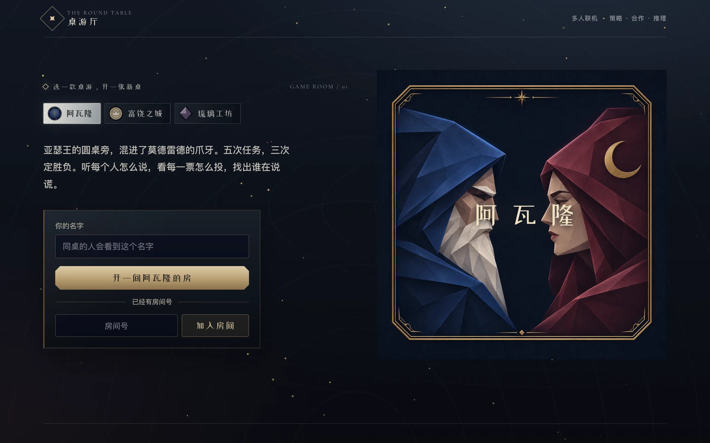
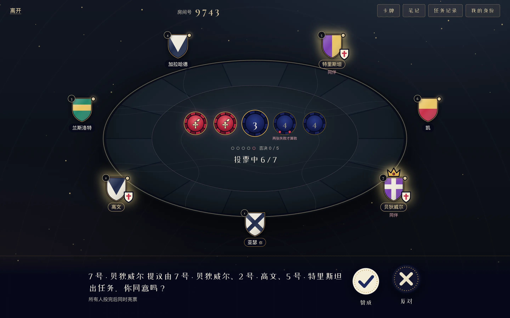
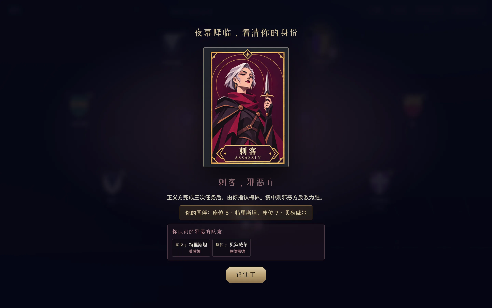
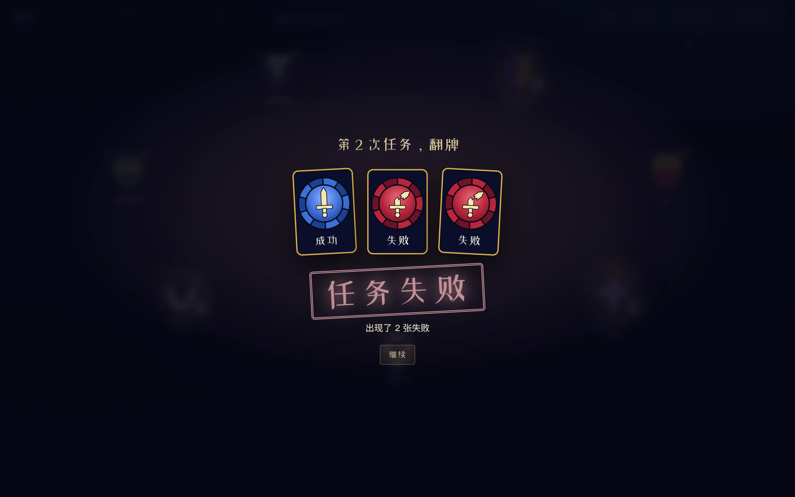
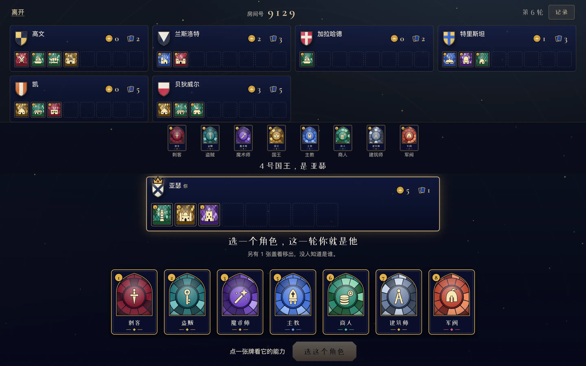
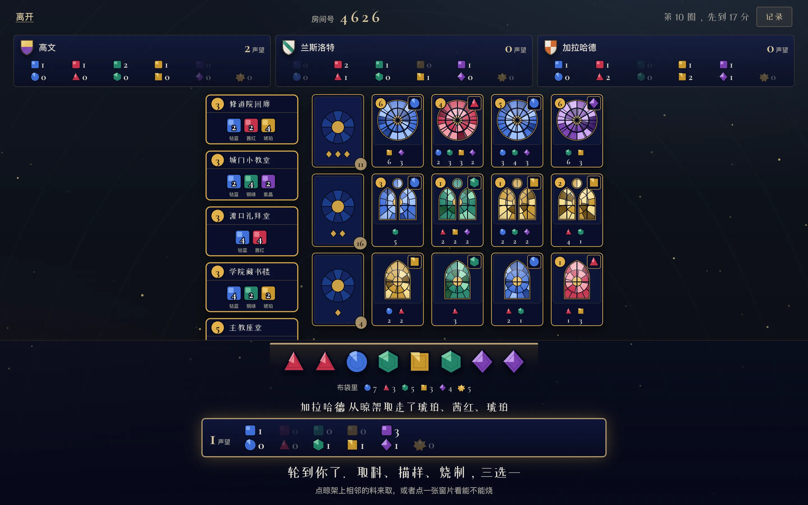
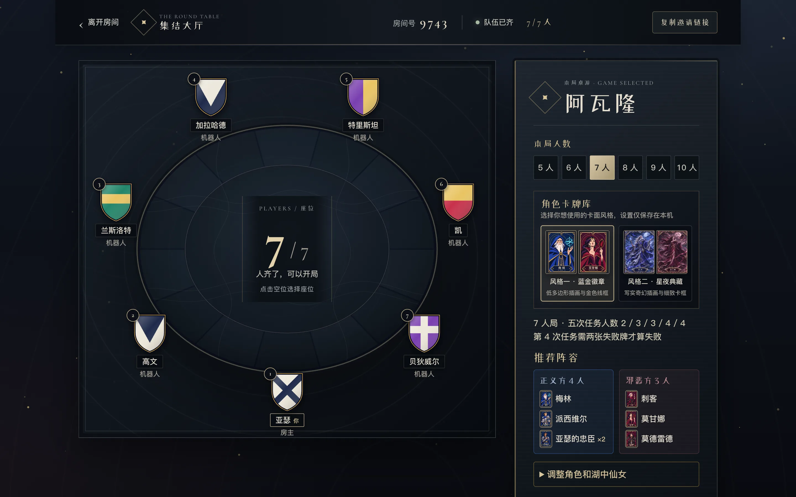
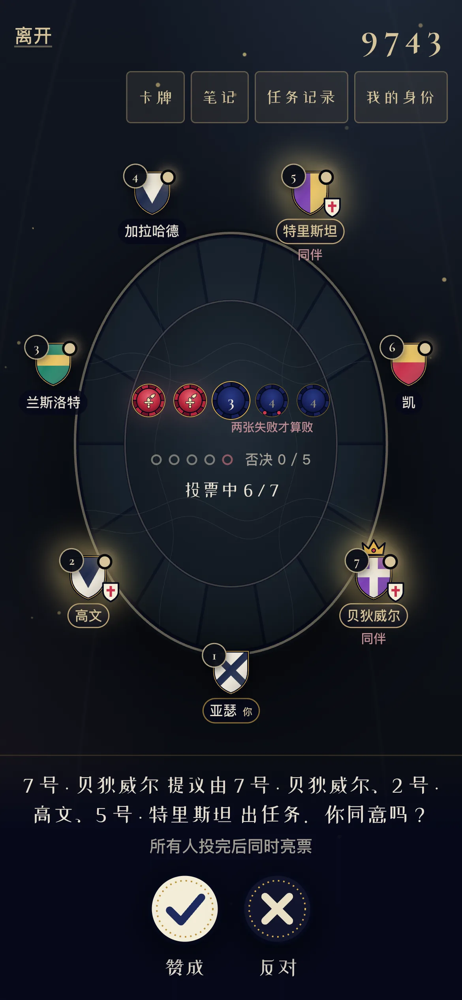

# 桌游厅

**在浏览器里和朋友玩桌游，不用下载，也不用注册。** 开一间房，把房间号或邀请链接发给朋友就能开局；人不够时，房主可以加机器人凑满一桌。

在线试玩：**[games.anois.site](https://games.anois.site)**

[](https://github.com/ddl123123123/avalon/actions/workflows/ci.yml)



## 收录的桌游

| 桌游 | 人数 | 时长 | 玩法 |
| --- | --- | --- | --- |
| **阿瓦隆** | 5–10 | 约 30 分钟 | 隐藏身份：组队、投票、暗出任务牌，找出谁在说谎 |
| **富饶之城** | 2–7 | 约 40 分钟 | 每轮暗中换一个角色，抢金币、建城区，先建满 8 座的人触发结算 |
| **琉璃工坊** | 2–4 | 约 20 圈 | 本项目原创：取玻璃料、烧制彩窗、承接委托，声望先到 17 分 |
| **七宗罪** | 3–7 | 7 幕 | 本项目原创：隐藏罪名，先协商再暗出牌，庄家匿名决定本幕提案 |

### 阿瓦隆

亚瑟王的圆桌旁混进了莫德雷德的爪牙。正义方要完成三次任务，邪恶方要破坏任务，或者在最后刺中梅林。
身份由系统秘密发放，建议开着语音一起玩。



<table>
  <tr>
    <td width="50%"></td>
    <td width="50%"></td>
  </tr>
  <tr>
    <td align="center">夜晚看清身份和同伴</td>
    <td align="center">任务翻牌</td>
  </tr>
</table>

- 支持梅林、刺客、派西维尔、莫甘娜、莫德雷德、奥伯伦和湖中仙女，按人数给出推荐阵容。
- 两套角色卡面可选（低多边形插画、写实奇幻插画），选择保存在自己的浏览器里。
- 随手记的私人笔记，只保存在自己的浏览器里；任务记录随时可以翻看每一轮的队伍和投票。
- 对局内 AI 助手提供队伍对比、角色教练、发言准备、规则问答和赛后复盘。你发起分析时，自己的身份线索、公开局势和主动选入的本机笔记会发送给 DeepSeek；结果仅返回给发起请求的玩家。

### 富饶之城

每一轮所有人暗中换上一副新面孔：刺客、盗贼、魔术师、国王、主教、商人、建筑师、军阀。
猜中对手是谁，护住自己的金币，抢先把城建起来。



### 琉璃工坊（原创）

彩窗匠人题材的引擎构筑游戏。五色玻璃料从布袋摸上晾架，轮到你时取料、描样、烧制三选一；
每烧成一块窗片，以后同色造价就少 1。炉子烧过还有余温，接着烧大窗能再省一两块料；
五色凑齐是一套「光谱」，同色的小窗、花窗、玫瑰窗凑齐是一组「联窗」，都另有声望。
数值用机器人自对战调过，两种打法胜率接近。



各款桌游实现了规则书的哪些内容、哪些地方是自行决定的，见 [docs/rules.md](docs/rules.md)。

## 怎么玩

1. 打开 [games.anois.site](https://games.anois.site)，选一款桌游，填个名字，开一间房。
2. 把四位数的房间号，或者「复制邀请链接」得到的链接发给朋友。
3. 人齐后房主点「开始游戏」。人不够就点「添加机器人凑人数」，机器人会按规则把牌局推进下去。

手机可以把桌游厅添加到主屏幕。iPhone 在 Safari 的分享菜单里选择「添加到主屏幕」，Android 在浏览器菜单里选择「安装」或「添加到主屏幕」。从微信打开时，可在右上角菜单选择用系统浏览器打开。在线对局需要网络。

<table>
  <tr>
    <td width="62%"></td>
    <td width="38%"></td>
  </tr>
  <tr>
    <td align="center">集结大厅：选人数、看推荐阵容、加机器人</td>
    <td align="center">手机上也能玩</td>
  </tr>
</table>

几点说明：

- 电脑和手机浏览器都能玩，页面会按屏幕宽度调整布局。
- 网络断了或手机切到后台再回来，会自动重连回原来的座位。首页会列出最近进入过的房间，可以一键回去。
- 注册账号是可选的。登录后座位跟着账号走：换手机、换电脑或清了浏览器缓存，登录同一个账号就能回到进行中的对局；游客时入的座，登录后自动归到账号名下。
- 登录态保存在 HttpOnly Cookie 里（页面脚本读不到）。勾选「保持登录」时 30 天内用过就自动续期，最长 180 天需重新输入密码；不勾选则关闭浏览器即退出。账号面板里可以改昵称、改密码、退出其他设备。
- 对局开始后不能再加入新玩家，也还不支持旁观和文字聊天。
- 房间保存在服务器内存里，服务更新时进行中的对局会被清空。账号保存在服务器的 Postgres 里，更新不受影响。

## 本地运行

需要 Node.js 22 和 pnpm 9.15.9。

```bash
git clone https://github.com/ddl123123123/avalon.git
cd avalon
corepack enable
pnpm install --frozen-lockfile
pnpm dev
```

打开 [http://localhost:5310](http://localhost:5310)。Vite 会把 `/ws` 代理到本地的房间服务（端口 8790）。

### 配置 DeepSeek AI 助手

复制 `.env.example` 中的变量到服务端环境，并填写 DeepSeek API Key。密钥只放在服务端，不能写入 `apps/web`、浏览器代码或提交到 Git。当前默认使用 `deepseek-flash` 和 `https://api.deepseek.com`；模型和计费可能调整，请以 [DeepSeek 官方模型与价格说明](https://api-docs.deepseek.com/quick_start/pricing/) 为准。

Windows PowerShell 本地开发时，复制模板并填写密钥。根目录 `.env` 已被 Git 忽略，启动服务时会由 Node.js 在本机读取：

```powershell
Copy-Item .env.example .env
notepad .env
pnpm dev
```

线上部署见 [DeepSeek 服务器配置](docs/deploy.md#deepseek-助手)。没有配置 Key 时，普通桌游功能仍可使用，助手会提示管理员配置服务端密钥。

```bash
pnpm test        # 规则引擎的单元测试
pnpm typecheck   # 全仓库类型检查
pnpm build       # 构建前端
PORT=8080 pnpm start   # 构建后，从同一个端口提供网页和 WebSocket
```

推送到 `main` 或提交拉取请求时，GitHub Actions 会跑上面三项检查。

**一个人调试多人局：**

- 大厅里点「添加机器人凑人数」。嫌机器人慢，可以用 `BOT_PACE=0.1 pnpm dev` 启动，机器人会快十倍。
- 地址后加 `?as=任意名字`，同一个浏览器的不同标签页就会被当作不同的玩家，例如
  `http://localhost:5310/?as=a` 和 `http://localhost:5310/?as=b`。

## 技术栈

- 前端：React 18、Vite 5、framer-motion；牌桌、纹章和大部分牌面是代码生成的 SVG。
- 服务端：Node.js 22 + `ws`，一个进程同时提供网页和 WebSocket。
- 规则：TypeScript 纯函数，前后端共用，用 Vitest 测试。
- 部署：Docker 镜像，推到 `main` 后由 GitHub Actions 自动发版到 [games.anois.site](https://games.anois.site)。

## 项目结构

```
packages/shared        与界面无关的部分，前后端共用
  src/framework.ts       GameDefinition：一款桌游需要实现的接口
  src/protocol.ts        房间与联机协议
  src/games/avalon/      阿瓦隆规则（rules.ts 是规则书里的数据，engine.ts 是状态机）
  src/games/citadels/    富饶之城规则（同样的两层结构）
  src/games/glassworks/  琉璃工坊（原创）：完整规则书写在 rules.ts 开头
apps/server            房间服务（WebSocket）。不了解任何具体规则，只调用 GameDefinition
apps/web               React 前端
  src/pages/             首页、入房、大厅（与桌游无关）
  src/ui/                通用圆桌、事件播报
  src/fx/                动效组件（微尘、点击火花、逐字浮现、立体倾斜）
  src/art/               通用 SVG 美术（玫瑰窗、玩家纹章、拱窗牌面、牌背、桌面）
  src/games/<id>/        各款桌游的牌桌、选项面板和美术
  public/avalon-cards/   阿瓦隆的角色卡与首页插画（另有 avalon-characters/ 角色立绘）
deploy/                compose 编排、Nginx 配置和发版脚本
docs/                  规则实现范围、部署说明、README 截图
design/                界面设计稿与出图提示词（不参与构建）
```

几条设计上的约定：

- **规则只在服务器上运行。** 每个玩家收到的是 `view(state, 自己)` 过滤后的视图，别人的身份、未公开的票和任务牌不会出现在网络数据里。
- **规则引擎是纯函数**，随机数由外部注入，所以可以确定性地测试。
- **美术以代码生成的 SVG 为主。** 玩家纹章由玩家 id 决定，角色牌的玻璃纹理由角色决定；阿瓦隆的角色卡和首页插画是位图。
- 系统开启「减弱动态效果」时，装饰性动画会停掉。

## 增加一款桌游

1. 在 `packages/shared/src/games/<id>/` 实现 `GameDefinition`（`setup` / `reduce` / `view` / `isOver`，可选 `botAction`），并在 `games/index.ts` 注册。规则数据放在 `rules.ts`，状态机放在 `engine.ts`。
2. 在 `apps/web/src/games/<id>/` 实现 `GameClient`（首页介绍 `hero`、大厅里的选项面板 `Options` 和牌桌 `Board`），并在 `games/registry.tsx` 注册。

房间、座位、断线重连、机器人调度都是现成的，不需要改服务器。

## 部署

线上站点 [games.anois.site](https://games.anois.site) 跑在一台腾讯云主机上。推到 `main` 后，GitHub Actions
在检查通过后自动发版；也可以在本机跑 `./deploy/ship.sh`。服务器布局、证书、回滚等细节见 [docs/deploy.md](docs/deploy.md)。
